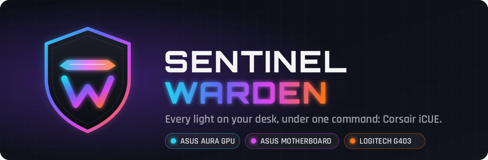
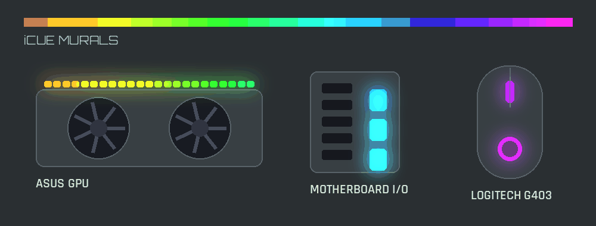
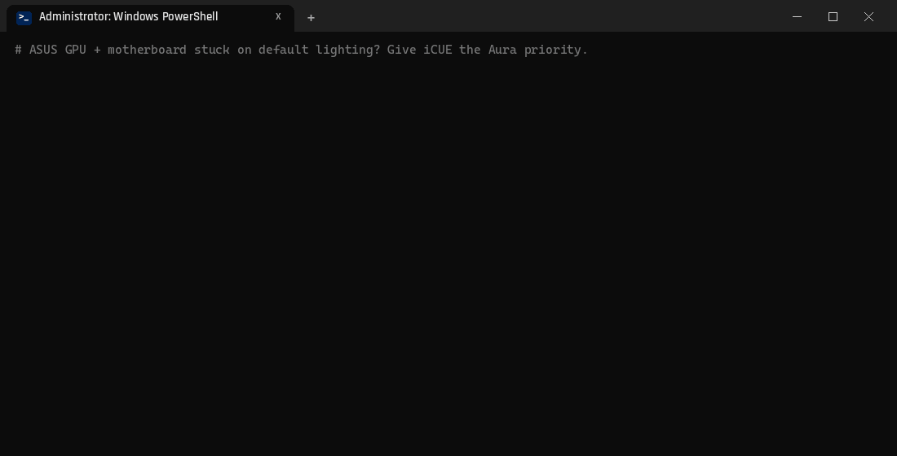
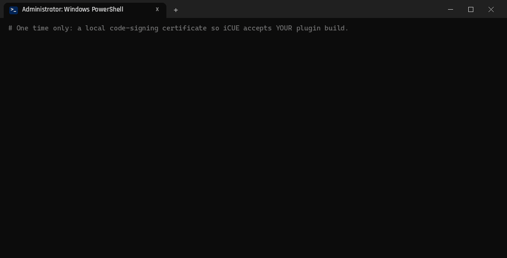
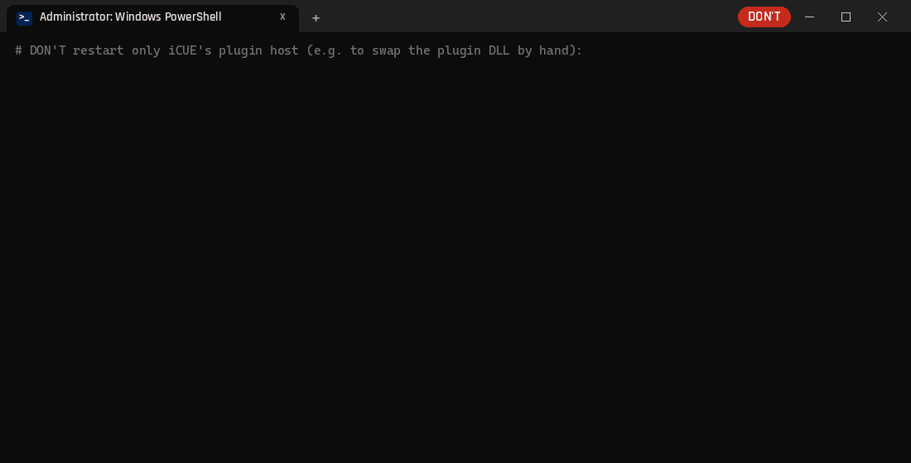

<p align="center">
  
</p>

<p align="center">
  
  
  
  
  
</p>

# Sentinel Warden

Two independent fixes for people who run **Corsair iCUE 5** as their one lighting app:

| Fix | Problem | Result |
|---|---|---|
| [ASUS Aura priority](#1-asus-aura-priority-fix) | After the 2026 Armoury Crate update (Aura Service 3.11 / Aura SDK 3.08.01) iCUE still *lists* your ASUS GPU and motherboard, but they keep their default lighting. | iCUE controls ASUS GPU + motherboard RGB again, also after a reboot. |
| [Logitech G403 plugin](#2-logitech-g403-plugin-for-icue) | iCUE has no Logitech support, so the mouse sits outside your iCUE effects and Murals. | The mouse shows up in iCUE as its own device (scroll wheel + logo) and can be placed on **Murals**. |

<p align="center">
  
  <br><sub>Illustration: one iCUE Mural driving the ASUS GPU, the motherboard I/O shroud and the Logitech G403 in sync.</sub>
</p>

Tested on Windows 11, iCUE 5.52, Armoury Crate 6.7.6 with Aura Service 3.11.08 / Aura SDK 3.08.01,
ASUS ROG Strix Z890-F + ROG Strix RTX 5070 Ti, G HUB 2026.6, Logitech G403 HERO.

> **Not affiliated with Corsair, ASUS or Logitech.** All trademarks belong to their owners.
> No files from those vendors are included: the scripts change a setting in ASUS's own config file,
> and the plugin loads the Logitech LED SDK that G HUB already installed on your PC.
> Use at your own risk.

---

## 1. ASUS Aura priority fix

### What is going on

iCUE drives ASUS RGB through its ASUS plugin, which talks to ASUS's Aura SDK. Since Aura SDK **3.08.01**
the SDK checks priorities before it hands over lighting control (with 3.07.05 the same log shows no such
check): an app only gets control if its priority in

```
C:\Program Files (x86)\LightingService\PriorityList.xml
```

is **higher** than the current owner's. After the update the file lists `LightingService.exe = 3` and
`iCUEDevicePluginHost.exe = 1`, so iCUE loses, and nothing tells you. The SDK's own log shows it,
`C:\ProgramData\ASUS\ARMOURY CRATE Diagnosis\LightingService\AuraSDK.log`:

```
[guidToken::CheckPriority] m_priority = 1 CurrentPriority = 3.
```

The fix raises iCUE's priority to 5. Two catches:

* **LightingService resets the file at every Windows boot**, so the fix has to be re-applied at logon.
* The order matters: LightingService has to be restarted **before** iCUE, so iCUE asks for control last.

### Install

1. Download [`asus-aura-priority/Set-iCUEAuraPriority.ps1`](asus-aura-priority/Set-iCUEAuraPriority.ps1)
   and put it in a folder that stays, for example `C:\Tools\iCUE-Aura\` (the log is written next to it).
2. Open **Terminal (Admin)** and run it once:

   ```powershell
   powershell -ExecutionPolicy Bypass -File "C:\Tools\iCUE-Aura\Set-iCUEAuraPriority.ps1"
   ```

   It backs up `PriorityList.xml` next to the script, sets iCUE to 5, restarts LightingService and
   restarts iCUE (as your normal user). Your ASUS GPU/motherboard should follow iCUE within ~20 s.

   
   <br><sub>The terminal demos in this README are re-enacted with output from real runs. Paths are generic,
   the thumbprint is an example, and log line numbers are illustrative.</sub>
3. Make it survive reboots with a logon task (same admin terminal; change the path if you used another folder):

   ```powershell
   $script  = 'C:\Tools\iCUE-Aura\Set-iCUEAuraPriority.ps1'
   $action  = New-ScheduledTaskAction -Execute 'powershell.exe' -Argument "-NoProfile -WindowStyle Hidden -ExecutionPolicy Bypass -File `"$script`" -AtLogon"
   $trigger = New-ScheduledTaskTrigger -AtLogOn -User "$env:USERDOMAIN\$env:USERNAME"
   $princ   = New-ScheduledTaskPrincipal -UserId "$env:USERDOMAIN\$env:USERNAME" -LogonType Interactive -RunLevel Highest
   Register-ScheduledTask -TaskName 'iCUE Aura priority' -Action $action -Trigger $trigger -Principal $princ
   ```

   With `-AtLogon` the script waits until iCUE is running (about a minute after logon), then applies the
   fix. iCUE restarts once, so its window may blink.

   

### Check / undo

* It worked if `AuraSDK.log` shows `m_priority = 5 CurrentPriority = 3` followed by `setGUID - done`.
* `Set-iCUEAuraPriority.log` (next to the script) shows each run.
* Undo: `Unregister-ScheduledTask -TaskName 'iCUE Aura priority' -Confirm:$false`.
  The next reboot puts ASUS's default back.
* **Avoid changing lighting in Armoury Crate's Aura Sync page while iCUE is in charge.** Armoury Crate
  can take the lights back. If your ASUS devices stop following iCUE, run the script again.

---

## 2. Logitech G403 plugin for iCUE

### What it is

`g403_plugin.dll` is an iCUE **device plugin**, the same kind of plugin iCUE uses for ASUS and NVIDIA
hardware. It adds a device called *Logitech G403 HERO* with two LEDs (scroll wheel, logo). Colours from
iCUE are forwarded to the mouse through the **Logitech LED SDK that G HUB installs**. G HUB stays the
mouse's driver and must keep running.

* Tested with the **G403 HERO**. The **G703** uses the same two zones in Logitech's SDK documentation
  (zone 0 = scroll wheel, zone 1 = logo), so it should work too, but it is untested. The SDK sends the
  colours to every connected Logitech mouse; how a mouse with a different zone layout reacts is untested.
* The plugin reports itself to iCUE as a **GPU-type device**. That is deliberate: when it reported itself as
  a mouse, iCUE did not offer it on Murals; as a GPU it is offered. In Murals it is therefore drawn with
  iCUE's GPU picture.
* Log: `C:\ProgramData\iCUE-G403-Plugin\g403-plugin.log`.

### Requirements

* Corsair iCUE 5 and Logitech G HUB, both running.
* In G HUB settings: **"Allow games & applications to control my lighting"** turned on.
* If you also have ASUS RGB: install fix 1 first. The installer below restarts LightingService in the right order.

### Why you need your own signing certificate

iCUE only loads plugin DLLs that carry a **valid Authenticode signature** that Windows trusts. A plugin from
a hobby project has no commercial signature, so you create a **local code-signing certificate on your own
PC**, tell Windows to trust it, and sign the DLL with it.

Security notes, read these before you do it:

* The private key is created **non-exportable**: Windows' own tools won't export it. That is not a vault,
  though. Malware or a person with admin rights on your PC could still dig it out, just as they could do
  far worse things already.
* Windows will trust **anything signed with this certificate on this PC**. Never share the certificate, and
  don't sign files you didn't build or download from here yourself.
* The certificate is limited to code signing. You can remove it at any time (see *Undo*).

### Install

1. Download `iCUE-G403-Plugin.zip` from [Releases](../../releases) and unzip it to a folder that stays, for
   example `C:\Tools\iCUE-G403-Plugin\`. You should have `Install-G403Plugin.ps1` and a `Logitech\` folder.
   (Or build it yourself, see below.)
2. **Create your signing certificate** in **Terminal (Admin)**. You only do this once:

   ```powershell
   $cert = New-SelfSignedCertificate -Type CodeSigningCert -Subject 'CN=Local iCUE plugin signing' `
       -CertStoreLocation Cert:\CurrentUser\My -KeyExportPolicy NonExportable `
       -KeyAlgorithm RSA -KeyLength 3072 -HashAlgorithm SHA256 -NotAfter (Get-Date).AddYears(10)
   Export-Certificate -Cert $cert -FilePath "$env:TEMP\icue-plugin-signing.cer" | Out-Null
   Import-Certificate -FilePath "$env:TEMP\icue-plugin-signing.cer" -CertStoreLocation Cert:\LocalMachine\Root
   Import-Certificate -FilePath "$env:TEMP\icue-plugin-signing.cer" -CertStoreLocation Cert:\LocalMachine\TrustedPublisher
   $cert.Thumbprint
   ```

   Windows asks whether you want to install a root certificate. Answer **Yes**. Write down the
   **thumbprint** that is printed last (40 hex characters). The certificate goes in the *machine*
   stores because iCUE's plugin host runs as a Windows service.

   
3. **Install the plugin** (same admin terminal):

   ```powershell
   cd C:\Tools\iCUE-G403-Plugin
   powershell -ExecutionPolicy Bypass -File .\Install-G403Plugin.ps1 -CertThumbprint <YOUR_THUMBPRINT>
   ```

   The script signs the DLL and checks that the signature is `Valid`, then copies `Logitech\` to
   `C:\Program Files\Corsair\Corsair iCUE5 Software\plugins\`. After that it restarts the iCUE plugin host,
   LightingService and iCUE in that order.

   
4. After ~30 s **Logitech G403 HERO** appears in iCUE. Set a colour on it or place it on a Mural.

To update, unzip the new release over the old folder and run step 3 again. If the old DLL is still in use, the
script renames it to `g403_plugin.dll.old-<time>`; iCUE ignores those, and the next run deletes them.

### Troubleshooting

| Symptom | Check |
|---|---|
| Device does not appear | iCUE log `%LOCALAPPDATA%\Corsair\Logs\CUE5\<newest>.log`: search for `g403_plugin`. `Signature verification failed` means the certificate is not in *LocalMachine\Root* or the DLL was not signed. |
| Device appears, mouse doesn't change | Plugin log: `Logitech SDK ready` must be there. `init failed` is normal right after boot, because G HUB starts minutes after iCUE. The plugin retries every 5 s. Check the G HUB "allow applications" setting. |
| ASUS GPU/motherboard lost iCUE colours after installing | Run fix 1 again. Restarting only iCUE's plugin host without then restarting LightingService leaves Aura's control token with the old process. |
| Murals stopped on all devices | Setting a colour on a single device in iCUE turns Murals off. Click a Mural again. |

### Undo

```powershell
# in Terminal (Admin), from the plugin folder
powershell -ExecutionPolicy Bypass -File .\Install-G403Plugin.ps1 -Remove
Get-ChildItem Cert:\CurrentUser\My, Cert:\LocalMachine\Root, Cert:\LocalMachine\TrustedPublisher |
    Where-Object Subject -eq 'CN=Local iCUE plugin signing' | Remove-Item
```

### Build it yourself

On Linux/WSL with MinGW-w64 (`apt install gcc-mingw-w64-x86-64 zip`):

```bash
cd logitech-g403-plugin
./build.sh            # -> dist/iCUE-G403-Plugin.zip (unsigned; you sign it during install)
```

`tools/make_images.py` (Pillow) redraws the device pictures and prints the SVG zone outlines used in
`src/g403_plugin.c`. Add `-DAS_MOUSE` to the gcc line to report the device as a plain mouse instead. That
works for colours but iCUE then leaves it out of Murals.

### How it was made

iCUE has no public SDK for device plugins. The interface in `src/icue_plugin.h` (exported functions,
the 19-entry function table, device/LED/view structures) was worked out by studying how iCUE's own
ASUS and NVIDIA plugins talk to iCUE's plugin host, for the sole purpose of making this independent
plugin work with iCUE. A future iCUE update can change that interface. If the plugin stops loading
after an update, please open an issue with your iCUE log.

---

## Do & Don't



| ❌ Don't | ✅ Do instead |
|---|---|
| Restart only `iCUEDevicePluginHost` (or copy a new plugin DLL in by hand). Aura keeps the old process as owner and your ASUS lights fall back to default. | Use `Install-G403Plugin.ps1`. It restarts plugin host, then LightingService, then iCUE. Already did it? Run `Set-iCUEAuraPriority.ps1`. |
| Change lighting in Armoury Crate's **Aura Sync** page while iCUE is in charge. Armoury Crate can take the lights back. | Leave Armoury Crate's services running (iCUE needs them) but keep its Aura page closed. If it grabbed control, run `Set-iCUEAuraPriority.ps1`. |
| Set a colour on a single device while you use **Murals**. iCUE switches Murals off for *every* device. | Change lighting from the Murals page, or click a Mural again to bring it back. |
| Turn off G HUB's *"Allow games & applications to control my lighting"*, or quit G HUB. | Keep G HUB running with that setting on. The plugin reconnects by itself when G HUB starts late after boot. |
| Run another app that drives the mouse's lighting through the Logitech SDK at the same time. The last one to connect wins. | Let the plugin be the only SDK client for the mouse. |
| Sign files you didn't build or get from this repo with your local certificate. Windows trusts everything it signs. | Use the certificate only for this plugin. Remove it when you uninstall (see *Undo*). |
| Run the scripts in a normal (non-admin) terminal. | Use **Terminal (Admin)**. The scripts check this first and stop with a clear message before they change anything. |

---

## License

[MIT](LICENSE)
